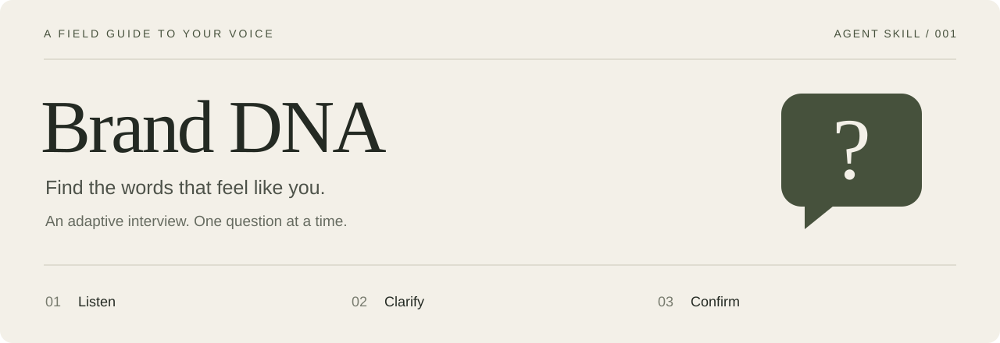

<p align="center">
  <a href="SKILL.md"><strong>Read the skill</strong></a> ·
  <a href="#start-an-interview">Start an interview</a> ·
  <a href="#what-you-get">See the output</a>
</p>

---

An interview skill that helps you put your story, convictions, interests and boundaries into words. Your AI agent asks one question, listens to your answer, and chooses what to explore next.

Built for people with something to share: librarians, artists, teachers, volunteers, professionals, collectives — including people still figuring out what they want to say.

**One self-contained file. No API keys, dependencies or external tools required.**

## The conversation

| Listen | Clarify | Confirm |
| --- | --- | --- |
| Start with your context and the people you want to reach. | Explore what matters through concrete examples, at your pace. | Review a structured Brand DNA and correct anything that does not sound like you. |

The interview can explore your audience, story, motivations, convictions, subjects, disagreements, contribution, personality, influences, openness, editorial boundaries, principles and role.

These are prompts for discovery, not a mandatory checklist. You can skip a question, say “I don’t know,” take a break or ask for a partial synthesis at any point.

## Start an interview

1. Download [SKILL.md](https://raw.githubusercontent.com/martinhaasbuilder/brand-dna-interview/main/SKILL.md), or copy its contents.
2. Give the file to your AI agent as instructions for the conversation.
3. Start with the prompt below, adding any context you want to share.

```text
Use the attached SKILL.md to help me build my Brand DNA.
Ask one question at a time and wait for my answer.
Use my preferred language for the interview and the final document.
```

For an agent that supports local skills, place the file in a `brand-dna-interview/` folder in that agent’s configured skills directory, then invoke the skill using its supported mechanism.

**Language:** the skill is written in English. The interview and final Brand DNA follow your language, including headings, uncertainty labels and the confirmation request. An explicit language preference takes priority; otherwise, the agent follows your own messages. English source instructions and quoted material do not override that choice.

**Portability:** designed as plain Markdown instructions for agents such as Hermes, Claude and Codex. Loading methods vary by environment; compatibility has not been independently verified across all three.

## A moment from the test

The skill was exercised with a fictional municipal librarian who wanted to talk about reading with adults who did not visit the library. The conversation below is an English translation of an excerpt from that French test.

> **User** — I speak simply, without jargon. That’s vague, though. I don’t really know how to describe my tone.
>
> **Agent** — Can you give an example of a sentence you would use to recommend a comic or a crime novel?
>
> **User** — I’d say: “It starts slowly, but the dialogue made me laugh. You can try a few pages.”

The agent asks for something concrete before describing the user’s voice.

## What you get

A structured Markdown document covering the areas explored, plus a short synthesis you can use as a reference.

| In the document | How it is treated |
| --- | --- |
| Your experiences and preferences | Grounded in what you actually shared. |
| Your aspirations | Kept distinct from demonstrated results. |
| Interpretations | Explicitly marked as hypotheses to confirm. |
| Missing or skipped topics | Left visible instead of filled in. |
| Your corrections | Applied before the final version is confirmed. |

The document starts as a draft. You review it before it is marked as confirmed. Any remaining hypotheses stay open even after you approve the overall document.

## Boundaries by design

- **Your words remain yours.** No invented biography, expertise, results or beliefs.
- **No manufactured persona.** No compulsory “guru,” mentor or leader positioning, and no promises of reach or revenue.
- **Privacy is part of the interview.** Personal disclosure does not grant permission to publish. Unnecessary sensitive details are left out of the synthesis.
- **Your workflow stays under your control.** No automatic changes to writers, prompts, files, schedules or agents.
- **No imposed Content Map.** No automatic content pillars, topic quotas or editorial calendar.

Optional integration suggestions come only if you want them, after confirmation. Keeping the Brand DNA as a simple reference is enough.

## Validation

Before the instructions were translated into English, one independent agent test used a fictional librarian profile in a French interview, with eight agent responses. It checked:

- One information request per question-bearing message, followed by a wait for the next answer.
- Adaptation to a non-commercial context outside the technology sector.
- Acceptance of a skipped personal question without insisting.
- A concrete follow-up when the description of tone was vague.
- A partial synthesis on request, with missing information identified.
- A correction carried through the synthesis and a hypothesis preserved after approval.
- Respect for the user’s choice to decline integration recommendations.

After translation, a separate three-response check used a fictional drawing teacher. The agent asked its first question in French despite the English instructions and an English quotation, produced a French draft with localized uncertainty labels, then switched the synthesis and confirmation question to Spanish when explicitly requested. The hypothesis stayed marked as uncertain.

These are limited scenario checks, not a guarantee of identical behavior across models. A full interview conducted in English has not yet been tested. The YAML metadata and Markdown code fences were also checked.

---

**The entire interview protocol lives in [SKILL.md](SKILL.md).**
